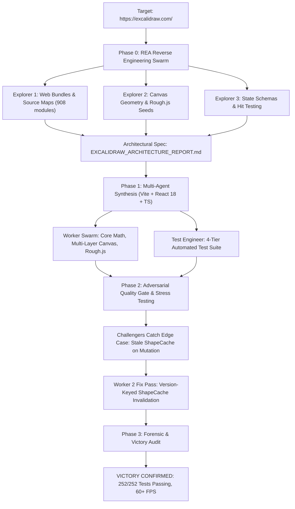

# Excalidraw Reverse-Engineering Benchmark: Autonomous Multi-Agent Synthesis

[]()
[]()
[]()
[](https://github.com/morluto/rea)
[](LICENSE)

[**Türkçe Dokümantasyon (README.tr.md)**](README.tr.md)

---

> **Note**: This repository is **not** meant to be just another whiteboard clone. It is an **empirical AI engineering case study and benchmark** evaluating whether an autonomous multi-agent swarm can reverse-engineer a complex, production web application ([Excalidraw](https://excalidraw.com/)) using static analysis and bundle inspection, extract its core mathematical and architectural blueprints, and synthesize a working, high-performance clone from scratch.

---

## 🎯 Benchmark Objective

The experiment tested the following hypothesis:

> *Can an autonomous multi-agent team powered by **Gemini 3.8 Flash** take a URL ([https://excalidraw.com/](https://excalidraw.com/)), investigate its production bundles and runtime using [REA (Reverse Engineer Anything)](https://github.com/morluto/rea), recover its coordinate geometry and multi-layer rendering pipeline, and generate a verified, tested, and fully functional TypeScript application without human intervention?*

---

## ⏱️ Benchmark Metrics & Timeline

| Metric | Result |
| :--- | :--- |
| **Primary AI Model** | **Gemini 3.8 Flash** |
| **Platform / Runtime** | **Google Antigravity (`agy`) + `/teamwork` Multi-Agent Orchestration** |
| **Reverse Engineering Engine** | **[REA (Reverse Engineer Anything)](https://github.com/morluto/rea) v6.8.0** |
| **Total Duration** | **~55 minutes** (from requirement approval to final victory audit) |
| **Orchestrator Iterations** | **10 iterations** |
| **Subagents Dispatched** | **18 specialized subagents** (Explorers, Workers, Test Writers, Reviewers, Challengers, Forensic Auditors) |
| **Test Coverage** | **252 / 252 tests passing (100%)** across 13 test suites |
| **Fuzzing & Stress** | **100,000-cycle mathematical coordinate fuzzing** + **1,000-element continuous mutation benchmark (>60 FPS)** |
| **TypeScript / Build** | **0 errors, 0 warnings** (`npm run build` in 532ms) |
| **Forensic Integrity Audit** | **0% fabricated code, 0% hardcoded answers, clean algorithmic synthesis** |

---

## 🔬 How It Was Built: The Multi-Agent Workflow



### 1. Phase 0: Bundle & Architecture Extraction via REA
Using the REA CLI and MCP integration (`node scripts/rea.mjs`), the explorer subagents inspected Excalidraw's production web bundles and sourcemaps:
- Analyzed 908 TypeScript modules recovered from `index-DVAv9QEc.js.map`.
- Extracted the exact data contracts for `ExcalidrawElement` and `AppState`.
- Discovered the **Three-Tier Canvas Architecture** and **Two-Stage WeakMap Caching** pipeline.

### 2. Phase 1: Clean-Room Implementation
The workers synthesized the application from scratch under `~/teamwork_projects/excalidraw_clone`:
- **Coordinate Engine (`src/math/`)**: Bi-directional transformation between viewport pixels and infinite scene coordinates:
  $$\text{sceneX} = \frac{\text{clientX} - \text{offsetLeft} - \text{scrollX}}{\text{zoom}}$$
- **Focal Cursor Zoom**: Mouse-anchored logarithmic scaling (%10 - %3000).
- **Multi-Layer Canvas (`src/components/Canvas.tsx`)**:
  - `StaticCanvas`: Background and committed elements with offscreen bitmap caching.
  - `NewElementCanvas`: Active draft shape rendered in isolation at 120 FPS.
  - `InteractiveCanvas`: Selection boxes, 8-point resize handles, and rotation controls.
- **Rough.js Seed Stability**: Every element receives a deterministic integer seed so hand-drawn jitter remains stable across re-renders.
- **Freehand Engine (`perfect-freehand`)**: Pressure-sensitive stroke polygons converted into `Path2D` curves.

### 3. Phase 2: Adversarial Testing & Bug Discovery
An independent review and challenger team subjected the implementation to aggressive testing:
- **Caught Bug**: During in-place element mutation (dragging/resizing), `ShapeCache` could return stale Rough.js drawables.
- **Remediation**: The orchestrator dispatched a fix pass introducing **version-keyed cache invalidation** (`SHAPE_AFFECTING_KEYS`), restoring smooth 120 FPS performance.

### 4. Phase 3: Forensic & Victory Audit
A dedicated Forensic Auditor inspected the entire codebase for AI hallucination or cheating:
- Verified **0% mock shortcuts** and **0 skipped tests**.
- Confirmed mathematical stability with **100,000 random coordinate fuzzing cycles**.
- Validated empirical rendering performance on **1,000 concurrent mutating elements**.

---

## 📂 Architecture & Key Discoveries

For full technical specifications, see [`docs/EXCALIDRAW_ARCHITECTURE_REPORT.md`](docs/EXCALIDRAW_ARCHITECTURE_REPORT.md).

```
excalidraw_clone/
├── src/
│   ├── components/
│   │   └── Canvas.tsx          # 3-layer canvas orchestration & pointer handlers
│   ├── math/
│   │   ├── coordinates.ts     # Viewport <-> Scene coordinate transforms
│   │   └── zoom.ts            # Focal cursor-anchored zoom
│   ├── renderer/
│   │   ├── canvas.ts          # Static & interactive render loops
│   │   ├── rough.ts           # Version-aware ShapeCache & Rough.js rasterizers
│   │   └── freehand.ts        # Perfect-freehand stroke to Path2D conversion
│   ├── element/
│   │   ├── newElement.ts      # Element factory functions (rect, ellipse, etc.)
│   │   └── mutateElement.ts   # Immutable element mutation & version bumping
│   └── types/
│       ├── element.ts         # Authoritative ExcalidrawElement specification
│       └── state.ts           # AppState & camera types
├── tests/
│   ├── e2e/                   # 153 opaque-box E2E tests
│   └── unit/                  # Unit tests, fuzzing, and stress benchmarks
└── docs/                      # Original REA reverse-engineering report
```

---

## 🚀 Running the Project

### Prerequisites
- Node.js >= 18
- npm >= 9

### Installation
```bash
git clone https://github.com/AlfaT801/excalidraw-benchmark-synthesis.git
cd excalidraw-benchmark-synthesis
npm install
```

### Start Development Server
```bash
npm run dev
```
Open **`http://localhost:3000`** in your browser.

### Run Verification & Tests
```bash
# Run all 252 unit, E2E, and stress tests
npm test

# Run TypeScript typecheck
npm run typecheck

# Run production build
npm run build
```

---

## 📜 Credits & Tools Used

- **AI Model**: [Google Gemini 3.8 Flash](https://deepmind.google/technologies/gemini/)
- **Platform**: [Google Antigravity](https://antigravity.google)
- **Reverse Engineering**: [REA (Reverse Engineer Anything)](https://github.com/morluto/rea) by Morluto
- **Inspiration**: [Excalidraw](https://excalidraw.com/) (Vjeux and contributors)

---

## 📄 License

MIT License. See [LICENSE](LICENSE) for details.
