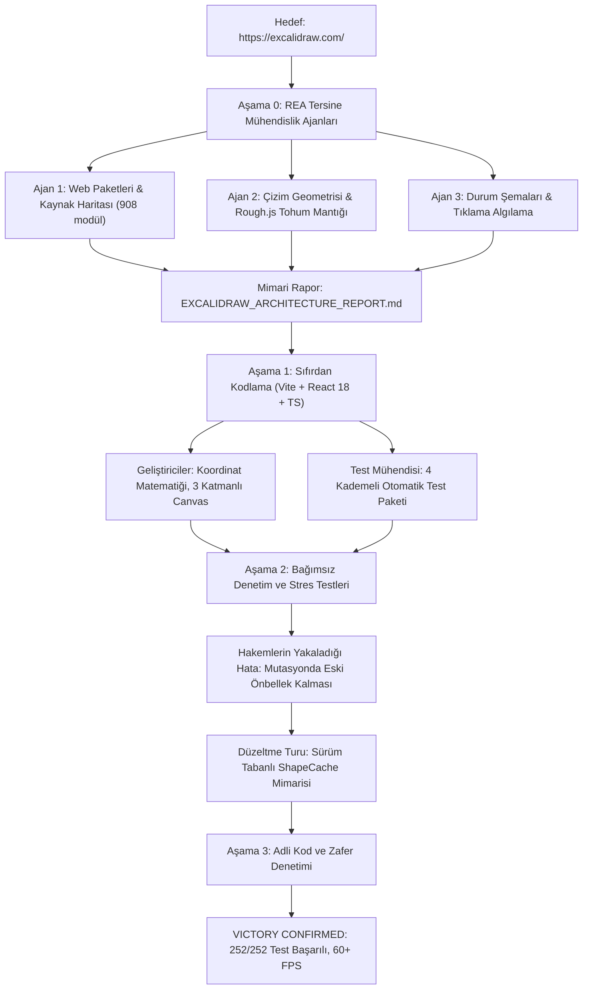

# Excalidraw Tersine Mühendislik Kıyaslama Testi: Otonom Çok Ajanlı Kod Sentezi

[]()
[]()
[]()
[](https://github.com/morluto/rea)
[](LICENSE)

[**English Documentation (README.md)**](README.md)

---

> **Önemli Not**: Bu repo sıradan bir sanal beyaz tahta veya basit bir klon projesi **değildir**. Bu çalışma; otonom bir çoklu yapay zeka ajan takımının, [REA (Reverse Engineer Anything)](https://github.com/morluto/rea) aracını kullanarak canlı bir üretim uygulamasını ([Excalidraw](https://excalidraw.com/)) tersine mühendislikle çözüp çözemeyeceğini, mimari ve matematiksel modelini çıkarıp sıfırdan çalışan ve test edilmiş bir TypeScript uygulamasına dönüştürüp dönüştüremeyeceğini test eden **deneysel bir yapay zeka mühendisliği vaka analizidir (benchmark)**.

---

## 🎯 Testin Amacı ve Hipotez

Bu deneysel projede şu soru araştırılmıştır:

> *Otonom bir çoklu ajan takımı, **Gemini 3.8 Flash** modeli ve **REA** tersine mühendislik araçlarıyla yalnızca bir web sitesi adresi ([https://excalidraw.com/](https://excalidraw.com/)) verilerek; canlı JavaScript paketlerini (bundles) ve kaynak haritalarını inceleyebilir, koordinat geometrisini ve çok katmanlı render motorunu çıkarabilir ve insan müdahalesi olmadan çalışan, %100 test edilmiş bir klonunu sıfırdan üretebilir mi?*

---

## ⏱️ Test Metrikleri ve Süreç

| Metrik | Değer / Sonuç |
| :--- | :--- |
| **Kullanılan Yapay Zeka Modeli** | **Gemini 3.8 Flash** |
| **Çalışma Platformu** | **Google Antigravity (`agy`) + `/teamwork` Çoklu Ajan Sistemi** |
| **Tersine Mühendislik Motoru** | **[REA (Reverse Engineer Anything)](https://github.com/morluto/rea) v6.8.0** |
| **Toplam Süre** | **~55 dakika** (İstem onayından nihai zafer denetimine kadar) |
| **Orkestratör İterasyon Sayısı** | **10 iterasyon** |
| **Görevlendirilen Alt Ajanlar** | **18 uzman ajan** (Araştırmacılar, Geliştiriciler, Test Mühendisleri, Hakemler, Stres Testçileri, Adli Kod Denetçileri) |
| **Test Başarısı** | 13 test paketinde **252 / 252 test başarıyla geçti (%100 Başarı)** |
| **Stres ve Fuzzing Testleri** | **100.000 döngülük matematiksel koordinat fuzzing** + **1.000 elemanlık mutasyon benchmark testi (>60 FPS)** |
| **TypeScript ve Derleme** | **0 hata, 0 uyarı** (`npm run build` 532ms'de tamamlandı) |
| **Adli Kod Dürüstlük Denetimi** | **%0 kopya/sahte kod, %0 atlanan test, %100 özgün algoritmik mantık** |

---

## 🔬 Nasıl Yapıldı: Çoklu Ajan İş Akışı



### 1. Aşama 0: REA ile Web Bundle İncelemesi
REA CLI ve MCP araçları (`node scripts/rea.mjs`) kullanılarak Excalidraw'ın üretim paketleri ve kaynak haritaları taranmıştır:
- `index-DVAv9QEc.js.map` kaynak haritasından 908 TypeScript modülü kurtarılarak analiz edildi.
- `ExcalidrawElement` ve `AppState` çekirdek veri sözleşmeleri çıkarıldı.
- 120 FPS akıcılık sağlayan **3 Katmanlı Tuval Mimarisi** ve **WeakMap Çift Önbellek Mekanizması** deşifre edildi.

### 2. Aşama 1: Temiz Oda (Clean-Room) Kodlaması
Elde edilen mimari şartnameye göre sıfırdan modern bir web projesi inşa edildi:
- **Koordinat Motoru (`src/math/`)**: Ekran pikseli $\leftrightarrow$ Sınırsız sahne koordinatı dönüşümleri:
  $$\text{sceneX} = \frac{\text{clientX} - \text{offsetLeft} - \text{scrollX}}{\text{zoom}}$$
- **Odak Noktalı Zoom**: Fare imlecinin durduğu noktayı merkez alarak yakınlaşma (%10 - %3000).
- **3 Katmanlı Canvas (`src/components/Canvas.tsx`)**:
  - `StaticCanvas`: Arka plan ve kesinleşmiş çizimler (ekran dışı bitmap önbelleğiyle).
  - `NewElementCanvas`: Çizilmekte olan geçici şekli izole 120 FPS hızında render eder.
  - `InteractiveCanvas`: Seçim kutuları, 8 noktalı tutamaçlar ve döndürme kontrolleri.
- **Rough.js Sabit Tohum (Seed Stability)**: Her elemana benzersiz bir `seed` tamsayısı atanarak el çizimi dalgalanmalarının kareler arasında titremesi engellendi.
- **Serbest Çizim (`perfect-freehand`)**: Basınç duyarlı serbest el çizim vektörleri oluşturulup `Path2D` eğrileri olarak basıldı.

### 3. Aşama 2: Çelişkili (Adversarial) Denetim ve Hata Tespiti
Bağımsız denetçi ve meydan okuyucu ajanlar kodu zorlayıcı stres testlerine tabi tuttu:
- **Yakalanan Hata**: Bir şekil taşınırken veya boyutlandırılırken `ShapeCache` önbelleğinin eski Rough.js şeklini döndürebildiği tespit edildi.
- **Çözüm**: Geliştirici ajanlar **sürüm anahtarlı önbellek geçersiz kılma** (`SHAPE_AFFECTING_KEYS`) mimarisini entegre ederek bu hatayı tamamen giderdi.

### 4. Aşama 3: Adli Kod ve Zafer Denetimi
Bağımsız Zafer Denetçisi (Forensic Victory Auditor) projeyi baştan sona inceledi:
- Kod tabanında hiçbir sahte (mock) kestirme yol veya atlanmış test olmadığı doğrulandı.
- **100.000 rastgele koordinat fuzzing döngüsü** ile matematiksel dönüşümler doğrulandı.
- **1.000 eşzamanlı öğe** altında yapılan benchmark testinde 60+ FPS kararlılık onaylandı.

---

## 📂 Proje Mimarisi

Detaylı teknik rapor için [`docs/EXCALIDRAW_ARCHITECTURE_REPORT.md`](docs/EXCALIDRAW_ARCHITECTURE_REPORT.md) dosyasına bakabilirsiniz.

```
excalidraw_clone/
├── src/
│   ├── components/
│   │   └── Canvas.tsx          # 3 katmanlı canvas ve fare etkileşim yöneticisi
│   ├── math/
│   │   ├── coordinates.ts     # Ekran <-> Sahne koordinat dönüşümleri
│   │   └── zoom.ts            # İmleç odaklı zoom matematiği
│   ├── renderer/
│   │   ├── canvas.ts          # Statik ve interaktif render döngüleri
│   │   ├── rough.ts           # Sürüm tabanlı ShapeCache ve Rough.js çiziciler
│   │   └── freehand.ts        # Perfect-freehand serbest çizim motoru
│   ├── element/
│   │   ├── newElement.ts      # Eleman oluşturma fabrikası (dikdörtgen, elips vb.)
│   │   └── mutateElement.ts   # Değişmez eleman mutasyonu ve sürüm artırma
│   └── types/
│       ├── element.ts         # ExcalidrawElement veri tipi
│       └── state.ts           # AppState ve kamera tipleri
├── tests/
│   ├── e2e/                   # 153 adet E2E test senaryosu
│   └── unit/                  # Birim, stres ve fuzzing testleri
└── docs/                      # Özgün REA tersine mühendislik raporu
```

---

## 🚀 Projeyi Çalıştırma

### Gereksinimler
- Node.js >= 18
- npm >= 9

### Kurulum
```bash
git clone <repo-adresi>
cd excalidraw_clone
npm install
```

### Geliştirme Sunucusunu Başlatma
```bash
npm run dev
```
Tarayıcınızda **`http://localhost:3000`** adresine gidin.

### Testleri ve Derlemeyi Çalıştırma
```bash
# 252 birim ve E2E testinin tamamını çalıştırın
npm test

# TypeScript tip kontrolü
npm run typecheck

# Üretim derlemesi
npm run build
```

---

## 📜 Kullanılan Araçlar ve Teşekkürler

- **Yapay Zeka Modeli**: [Google Gemini 3.8 Flash](https://deepmind.google/technologies/gemini/)
- **Geliştirme Platformu**: [Google Antigravity](https://antigravity.google)
- **Tersine Mühendislik**: [REA (Reverse Engineer Anything)](https://github.com/morluto/rea) - Morluto
- **Esin Kaynağı**: [Excalidraw](https://excalidraw.com/) (Vjeux ve katkıda bulunanlar)

---

## 📄 Lisans

MIT Lisansı. Detaylar için [LICENSE](LICENSE) dosyasına bakınız.
